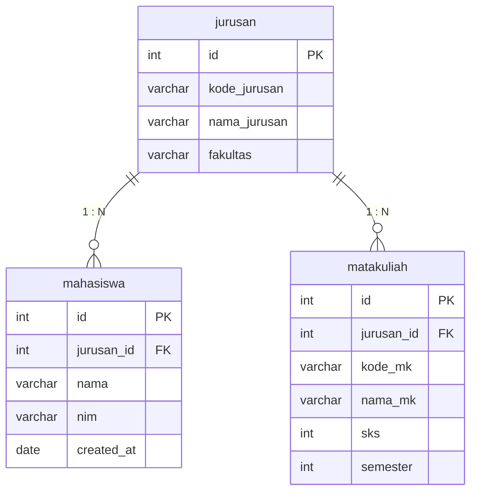

# PDCS UTS — REST API CRUD Mahasiswa & Jurusan

Tugas UTS mata kuliah **Pemrograman Database Client Server (IT027)**.

- Latihan pertemuan 1 & 2: modul **CRUD mahasiswa** (GET, POST, PUT, DELETE) dengan MySQL.
- Tugas UTS: modul **CRUD jurusan**.

Dibuat dengan PHP native (mysqli + prepared statement) dan diuji dengan **Thunder Client** di VS Code.

## Struktur project

```
uts
├── api
│   ├── mahasiswa.php          # CRUD mahasiswa (LEFT JOIN jurusan)
│   └── jurusan.php            # CRUD jurusan (tugas UTS)
├── helpers
│   ├── response.php           # sendResponse(): format JSON seragam
│   └── request.php            # CORS, baca body JSON, ?id=, validasi
├── database
│   └── pdcs.sql               # 3 tabel + foreign key + data contoh
├── config.php                 # koneksi MySQL + error HTTP 500
├── config.local.example.php   # contoh setting password lokal
└── start-server.bat           # server PHP di localhost:8080
```

## ERD



| Foreign key | Kalau jurusan dihapus |
|---|---|
| `mahasiswa.jurusan_id` → `jurusan.id` | `jurusan_id` mahasiswa menjadi `NULL` (ON DELETE SET NULL) |
| `matakuliah.jurusan_id` → `jurusan.id` | mata kuliah jurusan itu ikut terhapus (ON DELETE CASCADE) |

## Cara menjalankan

1. Jalankan MySQL (XAMPP/Laragon), buka phpMyAdmin.
2. Tab **Import** → pilih `database/pdcs.sql` → **Go**. Database `pdcs` dibuat lengkap dengan 3 tabel, foreign key, dan data contoh.
3. Kalau MySQL kamu memakai password, salin `config.local.example.php` menjadi `config.local.php` lalu isi `pass`. File ini tidak ikut di-commit.
4. Jalankan `start-server.bat`, atau taruh folder ini di `htdocs` / `www`.

Base URL: `http://localhost:8080/uts/api` (XAMPP/Laragon: `http://localhost/uts/api`).

## Endpoint

### Mahasiswa — `api/mahasiswa.php`

| Method | URL | Body JSON | Sukses |
|---|---|---|---|
| GET | `/mahasiswa.php` | – | `200 OK` |
| GET | `/mahasiswa.php?id=1` | – | `200 OK` |
| POST | `/mahasiswa.php` | `nama`, `nim`, `jurusan_id` (boleh `null`) | `201 Created` |
| PUT | `/mahasiswa.php?id=1` | field yang mau diubah | `200 OK` |
| DELETE | `/mahasiswa.php?id=1` | – | `200 OK` |

### Jurusan — `api/jurusan.php` (UTS)

| Method | URL | Body JSON | Sukses |
|---|---|---|---|
| GET | `/jurusan.php` | – | `200 OK` (plus jumlah mahasiswa & mata kuliah) |
| GET | `/jurusan.php?id=1` | – | `200 OK` (plus daftar mahasiswa & mata kuliah) |
| POST | `/jurusan.php` | `kode_jurusan`, `nama_jurusan`, `fakultas` | `201 Created` |
| PUT | `/jurusan.php?id=1` | field yang mau diubah | `200 OK` |
| DELETE | `/jurusan.php?id=1` | – | `200 OK` |

### Kode status error

| Status | Kapan |
|---|---|
| `400 Bad Request` | JSON tidak valid, `?id=` bukan angka, PUT/DELETE tanpa `?id=`, PUT tanpa data |
| `404 Not Found` | data dengan id tersebut tidak ada |
| `405 Method Not Allowed` | method selain GET, POST, PUT, DELETE |
| `409 Conflict` | NIM atau kode jurusan sudah dipakai |
| `422 Unprocessable Entity` | field wajib kosong, terlalu panjang, atau `jurusan_id` tidak ada |
| `500 Internal Server Error` | koneksi database gagal |

## Format response

Semua endpoint memakai `sendResponse($status, $message, $data, $httpCode)`:

```json
{
    "status": true,
    "message": "berhasil",
    "data": []
}
```

## Contoh request & response

### POST jurusan

```json
{
    "kode_jurusan": "TE",
    "nama_jurusan": "Teknik Elektro",
    "fakultas": "Teknik"
}
```

Response `201 Created`:

```json
{
    "status": true,
    "message": "Jurusan berhasil ditambahkan",
    "data": {
        "id": 4,
        "kode_jurusan": "TE",
        "nama_jurusan": "Teknik Elektro",
        "fakultas": "Teknik"
    }
}
```

### PUT jurusan `?id=4`

```json
{
    "nama_jurusan": "Teknik Elektro dan Komputer"
}
```

### DELETE jurusan `?id=1`

Response `200 OK`, termasuk efek foreign key:

```json
{
    "status": true,
    "message": "Jurusan berhasil dihapus",
    "data": {
        "id": 1,
        "kode_jurusan": "TI",
        "nama_jurusan": "Teknik Informatika",
        "fakultas": "Teknik",
        "dampak": {
            "mahasiswa_tanpa_jurusan": 2,
            "matakuliah_terhapus": 2
        }
    }
}
```

### POST mahasiswa

```json
{
    "nama": "Eka Putra",
    "nim": "202401006",
    "jurusan_id": 4
}
```

Response `201 Created`:

```json
{
    "status": true,
    "message": "Mahasiswa berhasil ditambahkan",
    "data": {
        "id": 6,
        "nama": "Eka Putra",
        "nim": "202401006",
        "jurusan_id": 4,
        "jurusan": "Teknik Elektro",
        "created_at": "2026-11-24"
    }
}
```

### Validasi gagal (`422`)

```json
{
    "status": false,
    "message": "Validasi gagal",
    "data": {
        "nama_jurusan": "wajib diisi",
        "fakultas": "wajib diisi"
    }
}
```

## Pengujian di Thunder Client

1. Buka Thunder Client → **New Request**.
2. Pilih method dan isi URL, misalnya `http://localhost:8080/uts/api/jurusan.php`.
3. Untuk POST dan PUT: tab **Body** → **JSON**, isi data seperti contoh di atas.
4. Klik **Send** dan cek status di kanan atas.
